# Aerial Pipeline

The aerial pipeline turns one drone flight into a field map, then into plots, plot images and per-plot traits. Each flight date is a run. Open one from the workspace's run list (see [Workspaces & Runs](workspaces.md)). The steps, in order:

| Step | What it does | Needed? |
|---|---|---|
| 1. Data sync | Checks the images are in place and reads each one's GPS position | Yes (automatic) |
| 2. Image exclusion | Leave out take-off, landing, blurry or off-field images | Optional |
| 3. GCP selection | Mark ground control points for accurate positions | Optional, recommended |
| 4. Orthomosaic | Stitch the images into one map of the field, with an elevation model | Yes |
| 5. Plot boundaries | Place the plot grid on the map and attach the field design | Yes |
| 6. Plot images | One image per plot, cut from the map or picked from the raw frames | For inference and viewing |
| 7. Trait extraction | Vegetation fraction, canopy height, canopy temperature per plot | Yes |
| 8. Inference | Run a model on the plot images (counts, detections) | Optional |

A run that starts from an uploaded orthomosaic skips steps 1–4.

<video controls muted playsinline width="100%" poster="../video/aerial-steps.webp" src="../video/aerial-steps.webm"></video>

## 1. Data sync

Confirms the run's images are present and reads each image's GPS position. Nothing needs doing unless the images carry no position, or a poor one (a phone camera, for example). In that case, upload the drone's flight log or a GPS track (*GPS Logs*: ArduPilot `.bin`/`.log`, GPX, NMEA, CSV, `.pos`) or a GPS table (*Synced Metadata*) for the same date. **Start Sync** lists the logs it found; positions are interpolated at each image's capture time. If the camera's clock has no time zone, it is shifted by the whole hours that fit the log, or set the zone in the dialog. The result names the logs used, the clock shift, and any images left without a position.

## 2. Image exclusion (optional)

Every image is a dot on a satellite map. Leave out the ones ODM should not use: take-off and landing frames, turns, blurry shots, frames off the field.

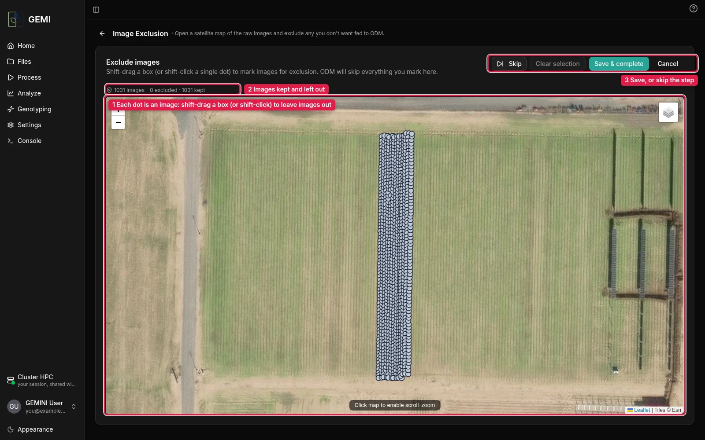

1. **Shift-drag a box** over dots to leave those images out (shift-click for a single image).
2. The count of images **kept and left out**.
3. **Save & complete**, or **Skip** the step.

## 3. GCP selection (optional, recommended)

Ground control points (GCPs) are markers on the ground at surveyed positions. Marking them in the images ties the orthomosaic to its true position, so maps of different dates line up. ODM needs at least three GCPs marked to use them.

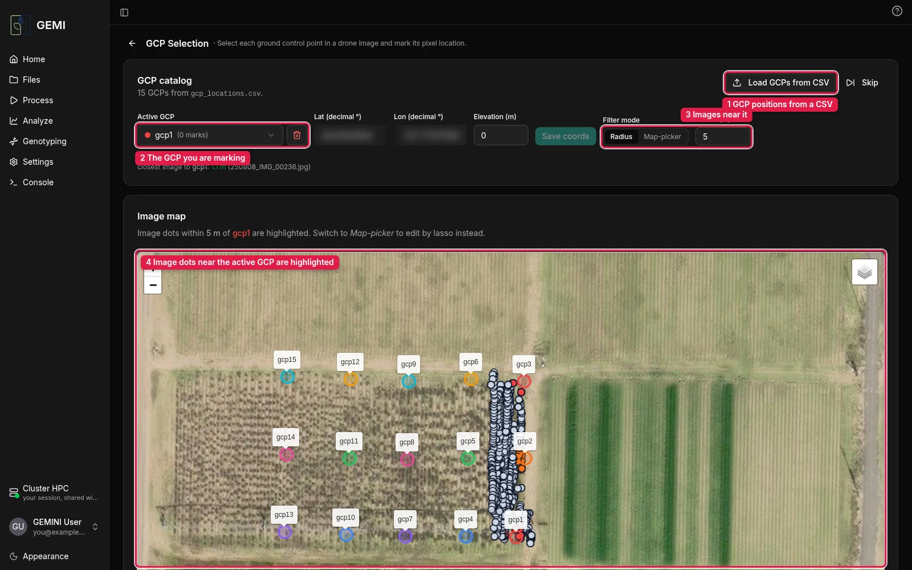

1. **Load GCPs from CSV**: each GCP's name, latitude, longitude and elevation.
2. **The GCP you are marking.** Pick one from the list.
3. **Images near it**: within a radius of the GCP, or picked on the map with a lasso (*Map-picker*).
4. **The image map.** The dots near the active GCP are highlighted, and the GCPs are drawn at their positions.

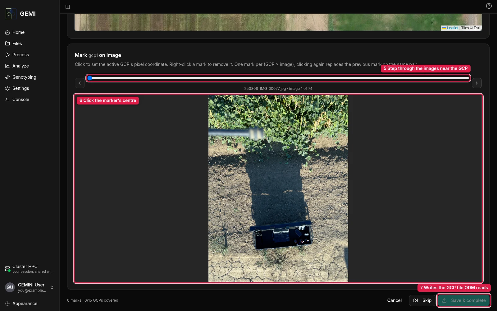

5. **Step through** the images near the GCP.
6. **Click the marker's centre** in the image. Right-click a mark to remove it. Mark each GCP in every photo that shows it.
7. **Save & complete** writes the GCP file ODM reads. ODM uses the GCPs when at least three are marked, each in three or more photos.

## 4. Orthomosaic

Runs OpenDroneMap on the images (and GCPs, if marked). The result is an orthomosaic and an elevation model; the elevation model gives plant height.

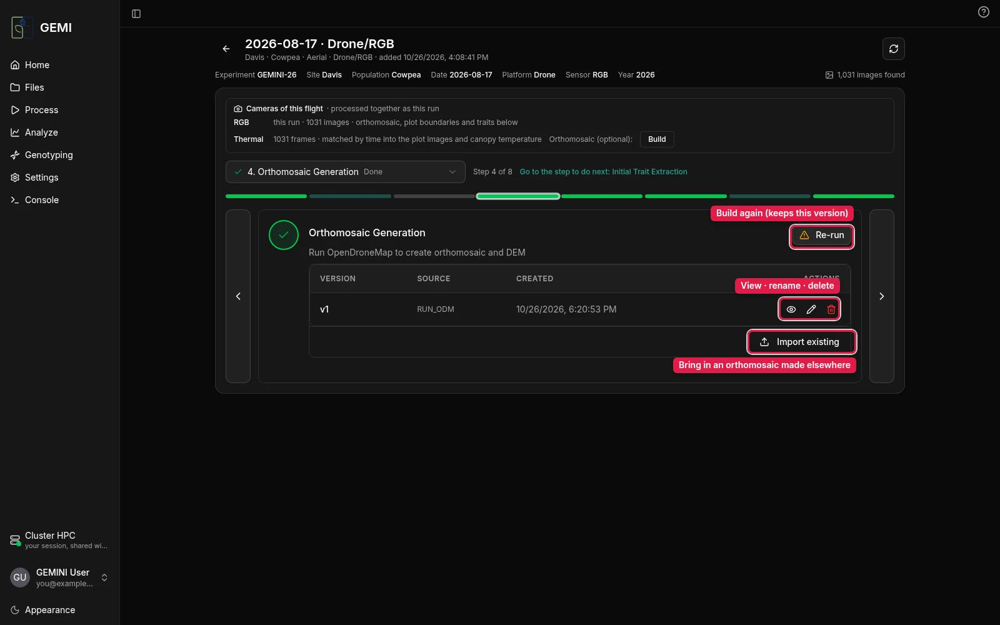

Each build is kept as a **version**:

- **View, rename or delete** a version.
- **Import existing** brings in an orthomosaic made elsewhere.
- **Re-run** builds again and keeps the earlier version.

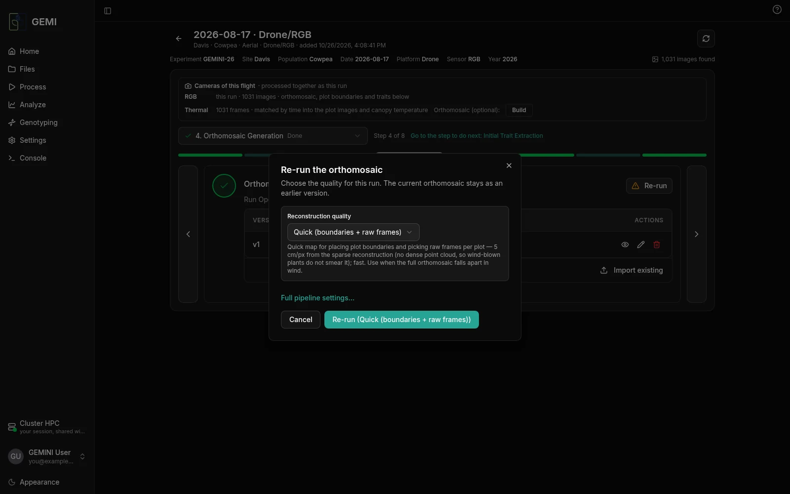

Pick a quality when building:

| Quality | Use it for |
|---|---|
| **Quick (boundaries + raw frames)** | Placing plot boundaries and picking raw frames per plot. A 5 cm/px map from the sparse reconstruction, so wind-blown plants do not smear it. Fast. Use it when the full orthomosaic falls apart in wind. |
| **Draft** | Fast previews (5 cm/px). |
| **Standard** | Most surveys (3 cm/px). |
| **High Quality** | Final maps (2 cm/px). |
| **Ultra** | The finest maps (1 cm/px). Very slow and memory-hungry. |
| **Detailed map** | A 1 cm/px map for plant counts and plot images, with light 3D. Fits where Ultra runs out of memory. |
| **Custom** | Your own OpenDroneMap options. |

The viewer (the eye icon) shows the map. It downloads as a GeoTIFF, or as a Cloud-Optimized GeoTIFF (COG) for GIS software.

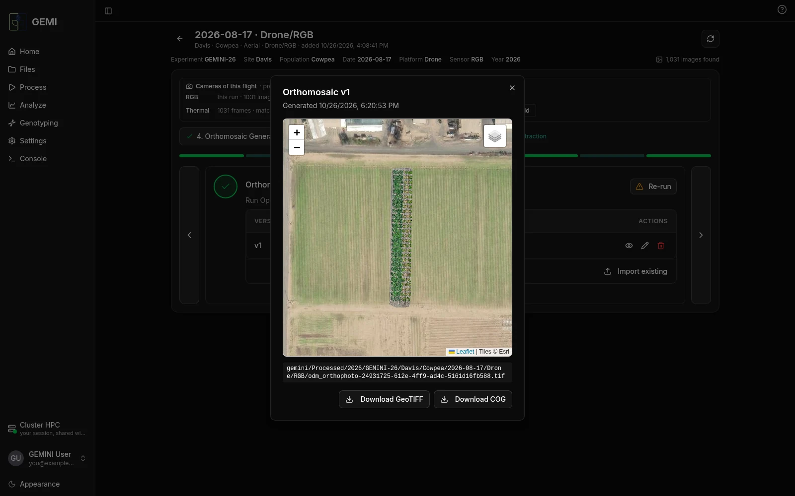

## 5. Plot boundaries

Place one polygon per plot over the orthomosaic and attach the field design: plot number, row, column and accession. Boundaries saved for one date can be imported to another and shifted to fit.

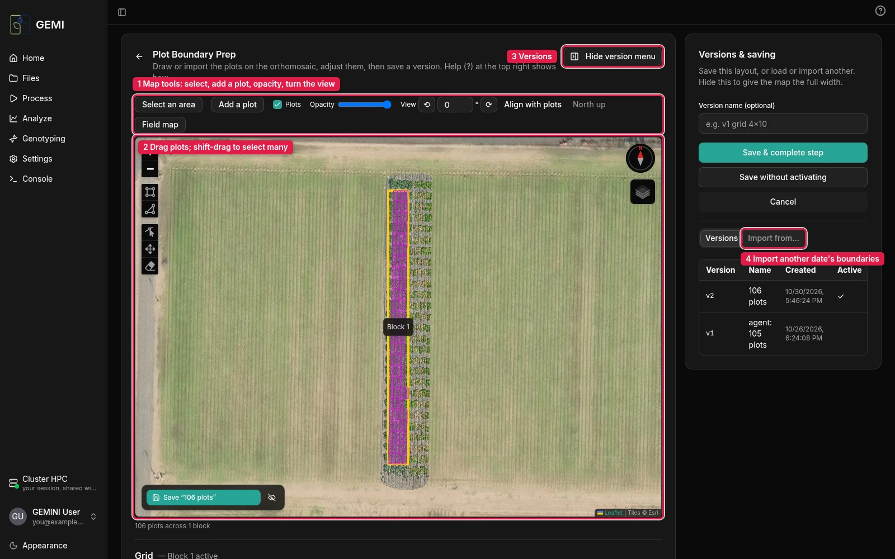

1. **Map tools.** *Select an area*, *Add a plot*, show or hide the plots, the plots' opacity, and turning the view so rows run straight (*Align with plots*, *North up*).
2. **The map.** Drag a plot to move it. Shift-drag to select many, then move them together. The tools on the map's left edge draw, edit, move and delete shapes.
3. **Versions.** Save the layout as a version and make it the active one (*Save & complete step*), or save without activating it. Load an earlier version from the list.
4. **Import from…** another date's boundaries.

Below the map, **Grid** builds the plots for you:

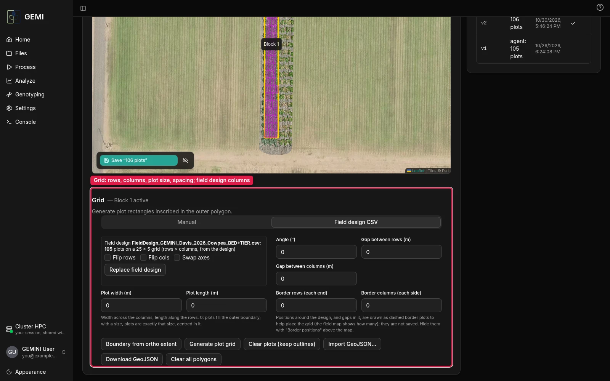

- **Field design CSV**: one plot per row of the design, laid out by its rows and columns. Use *Flip rows*, *Flip cols* and *Swap axes* if the grid comes out mirrored or turned.
- **Manual**: a number of rows and columns.
- **Plot width, plot length, gaps and border rows** set the plot size and spacing; 0 fits the plots to the outer boundary.
- **Boundary from ortho extent** draws an outer boundary to start from. **Generate plot grid** fills it.
- **Import GeoJSON** or **Download GeoJSON** to move boundaries in or out of GIS software.

!!! tip "Several treatments in one field"
    When a field was flown in parts (for example a well-watered and a drought block), the tool shows each part's orthomosaic where it is nearest. One set of boundaries can cover both, and each plot's results are kept with its treatment.

## 6. Plot images

One image per plot, for the plot viewer and for inference. Trait extraction does not need them. There are two sources:

- **Orthomosaic**: each plot is cut out of the map.
- **Raw frames**: for each plot, the flight frames that show it best (the whole plot in frame, then the most top-down). They are placed with the camera positions of the orthomosaic the boundaries were drawn on. Raw frames are sharper than the map and do not smear in wind, so a Quick orthomosaic is enough. The flight's other cameras are matched by capture time and cut the same way, so a thermal camera gives each plot a thermal image and a canopy temperature.

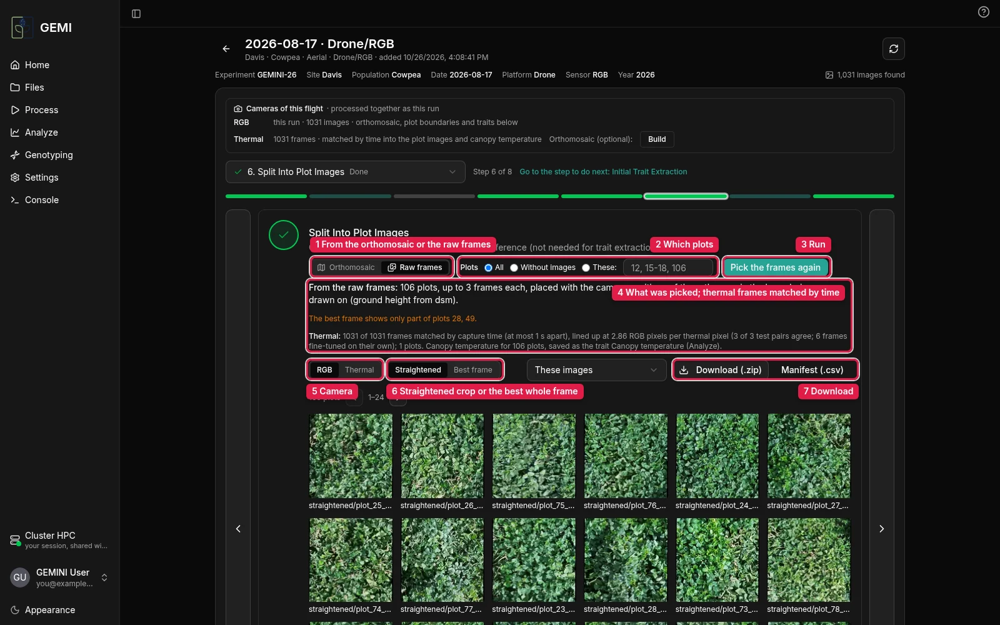

1. **Orthomosaic or raw frames.**
2. **Which plots**: all, only those without images yet, or a list (for example `12, 15-18, 106`, such as a plot just added to the boundaries).
3. **Run** (*Pick the frames again* re-picks them).
4. **What was picked**: how many plots and frames, any plot only partly in frame, and how the thermal frames were matched.
5. **Camera**: RGB, or the flight's other cameras.
6. **Straightened**: the best frame turned top-down to the plot. **Best frame**: the whole frame it came from.
7. **Download** the images (zip), or the manifest (CSV) of which frame each plot came from.

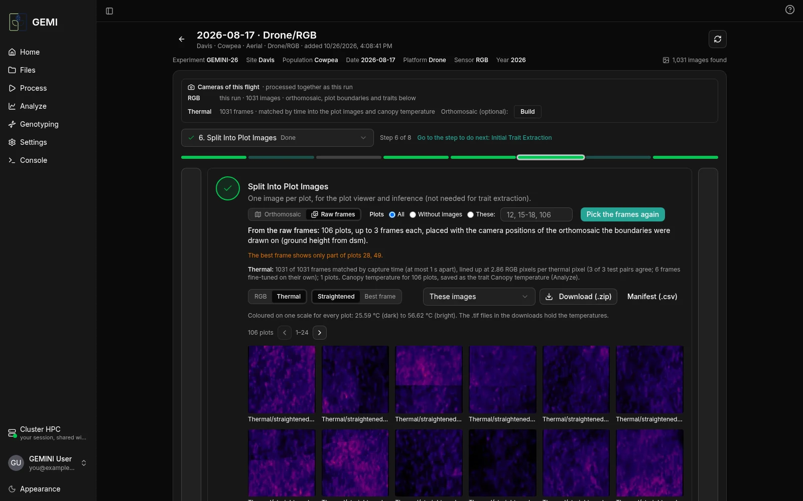

The thermal images are coloured on one scale for every plot. The `.tif` files in the download hold the temperatures.

## 7. Trait extraction

Measures each plot from the orthomosaic and plot boundaries:

- **Vegetation fraction**: the share of the plot covered by plants.
- **Canopy height**: from the elevation model.
- **Canopy temperature**: from the thermal camera, when it was flown.

The results are stored per plot and appear in Analyze.

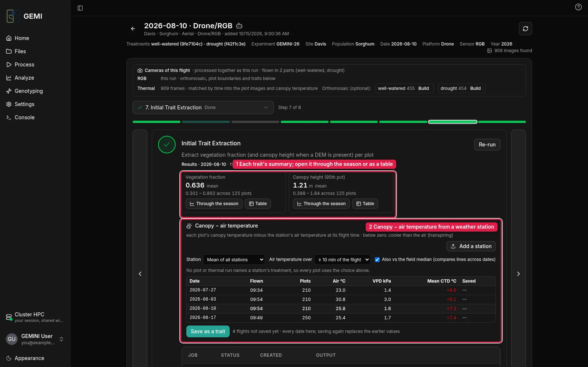

1. **Each trait's summary**: its mean and range across the plots. Open it **through the season** (a chart) or as a **table**.
2. **Canopy − air temperature** compares each plot's canopy temperature with the air temperature from a weather station at the flight's time. Below zero, the canopy is cooler than the air (transpiring). Upload a station's records with **Add a station**, pick the station and time window, then **Save as a trait**.

## 8. Inference

Runs a detection, segmentation or classification model over the plot images, for example to count panicles, flowers or pods. Its counts are stored per plot as traits. See [Inference & Training](inference.md).
