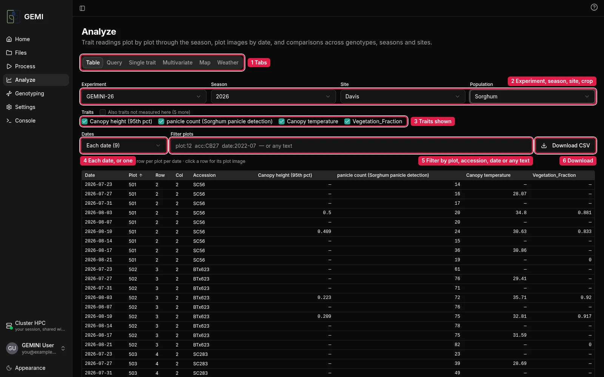
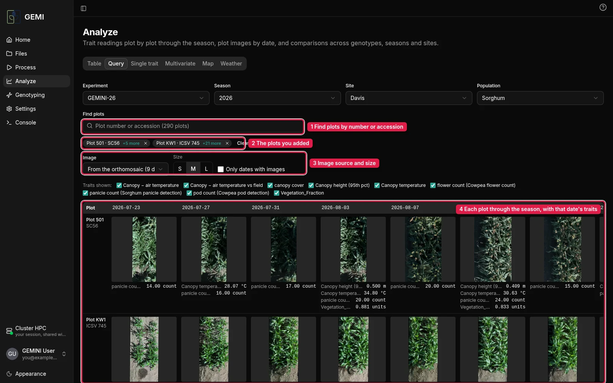
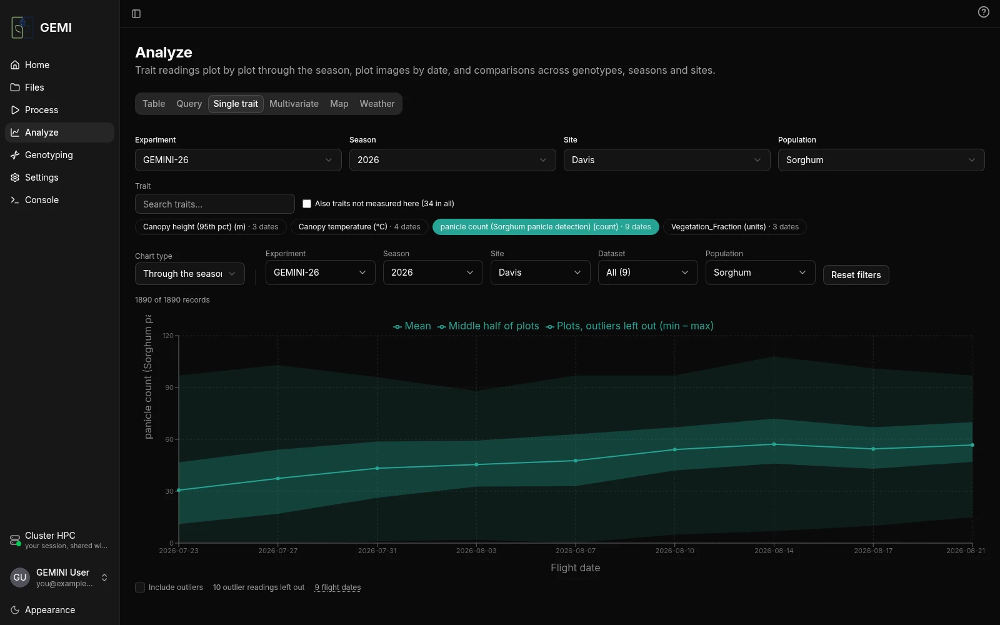
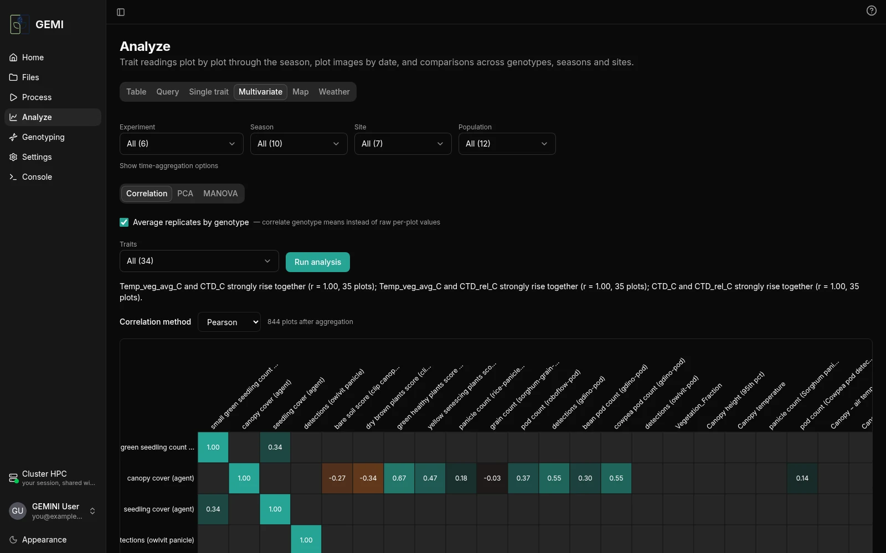
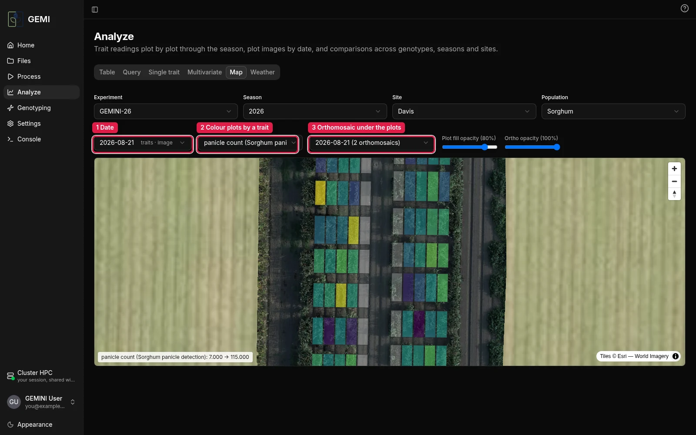
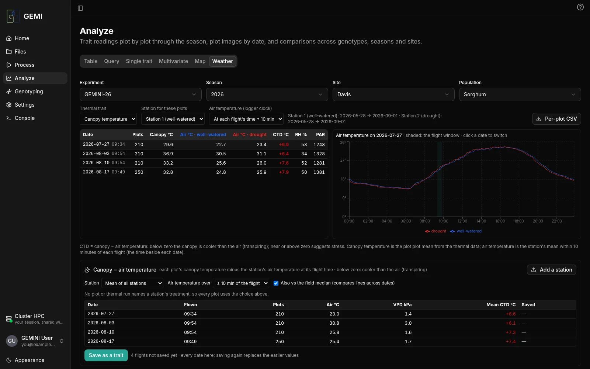

# Analyze

**Analyze** shows the measured traits plot by plot through the season. Every trait lands here: from trait extraction, from models, from thermal images, from weather stations, and from reference data you uploaded. Pick an **experiment, season, site and population** at the top; every tab works on that choice.

<video controls muted playsinline width="100%" poster="../video/analyze.webp" src="../video/analyze.webm"></video>

## Table

Every plot's traits on each date, a row per plot per date.

1. **Tabs**: Table, Query, Single trait, Multivariate, Map, Weather.
2. **Experiment, season, site and population (crop).**
3. **Traits shown.** *Also traits not measured here* adds traits from other experiments and sites.
4. **Each date**, or one date.
5. **Filter plots** by plot number (`plot:12`), accession (`acc:CB27`), date (`date:2022-07`) or any text.
6. **Download CSV.**

Click a row to see that plot's image on that date.

## Query

Find plots and see their images across the season, with each date's traits under the image.

1. **Find plots** by plot number or accession. An accession adds all of its plots.
2. **The plots you added.** Remove one with its ×, or clear them all.
3. **Image source and size.** Plot images from the orthomosaic, the raw frames or the thermal camera; small, medium or large. *Only dates with images* hides the empty dates.
4. **Each plot through the season**, a row per plot and a column per date. Click an image to open it full size.

## Single trait

Pick a trait to see it through the season, plot by plot, or across genotypes and sites.

**Chart type**:

- **Through the season**: the mean, the middle half of the plots, and the range on each date.
- **Season table**: a plot per row, a date per column.
- **Histogram.**

Outliers are left out by default; *Include outliers* shows them. Narrow the chart by experiment, season, site, dataset or population.

## Multivariate

Several traits together:

- **Correlation**: which traits rise and fall together.
- **PCA**: the main axes of variation across plots.
- **MANOVA**: whether genotypes differ across several traits at once.

*Average replicates by genotype* correlates genotype means instead of single plots. Pick the experiments, seasons, sites and traits, then **Run analysis**.

## Map

Each date's orthomosaic with its plots coloured by a trait.

1. **Date.**
2. **Colour plots by a trait** (a heatmap), or show outlines only.
3. **The orthomosaic under the plots**, with the opacity of each layer.

Click a plot for its traits and image.

## Weather

Weather station records beside the flights: the air temperature through each flight day, with the flight's window shaded. A table compares each flight's canopy temperature with the air temperature (CTD, canopy − air), along with humidity, vapour pressure deficit (VPD) and light (PAR). Each treatment can have its own station. Upload station records as **Weather Data** in Files, or with **Add a station**.

