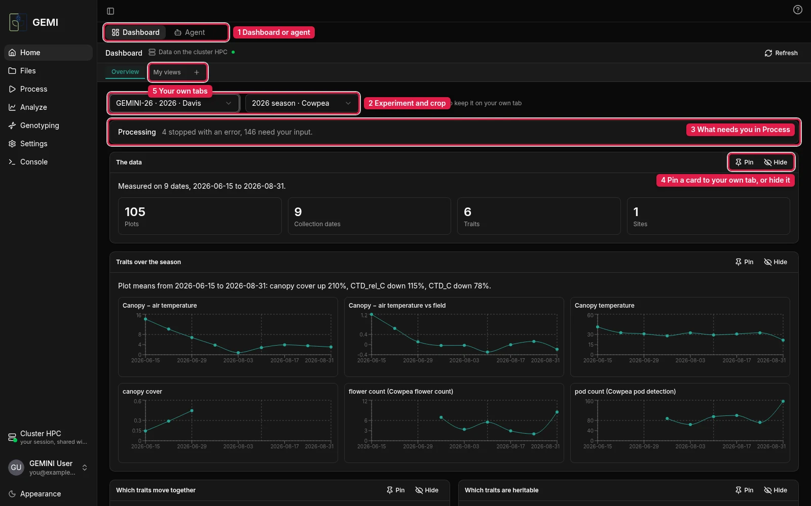
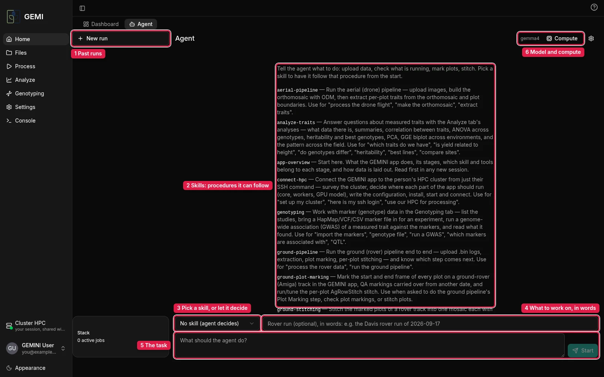

# Home: Dashboard & Agent

**Home** has two tabs: the **Dashboard**, an overview built from your trait data, and the **Agent**, an assistant that does the work for you. You can turn either off in *Settings → Application → Home*.

## Dashboard

1. **Dashboard or agent.**
2. **Experiment and crop**: the dashboard covers one experiment, site and season, and one crop.
3. **What needs you in Process**: runs that stopped with an error or need your input. *Open Process* goes there.
4. **Pin** a card to keep it on your own tab, or **Hide** it.
5. **Your own tabs** (*My views*). **+** adds one.

The overview's cards:

- **The data**: plots, dates, traits and sites.
- **Traits over the season**: each trait's plot mean on each date, with a one-line summary of what changed.
- **Which traits move together**: correlations between traits.
- **Which traits are heritable**: broad-sense heritability (H²) of each trait, from a mixed model.
- **BLUPs**: each accession's estimated genetic value per trait, to rank lines.

## Agent

The agent does in the app what you ask in plain words. It can:

- upload data;
- run pipeline steps and mark plots;
- check jobs and tell you why one failed;
- answer questions about the traits;
- run a GWAS.

It follows **skills**: written procedures for each kind of task. Its runs, and anything it changed, carry a small robot mark in Process.

1. **Past runs** of the agent; **New run** starts another.
2. **Skills**: the procedures it can follow, each with the kind of request it is for.
3. **Pick a skill**, or let the agent decide.
4. **What to work on, in words**: for example *the Davis rover run of 2026-09-17*. The agent finds the run.
5. **The task**: what the agent should do.
6. **The model** the agent thinks with, and the **compute** it uses.

Some example requests:

- *"Process the drone flight of 2026-08-17 at Davis up to the plot images."*
- *"Which jobs failed this week, and why?"*
- *"Is panicle count related to canopy height in the sorghum?"*
- *"Run a GWAS of flowering time at Riverside 2015."*

The agent works through the same app, so everything it does shows in Process, Analyze and the jobs panel like your own work.
