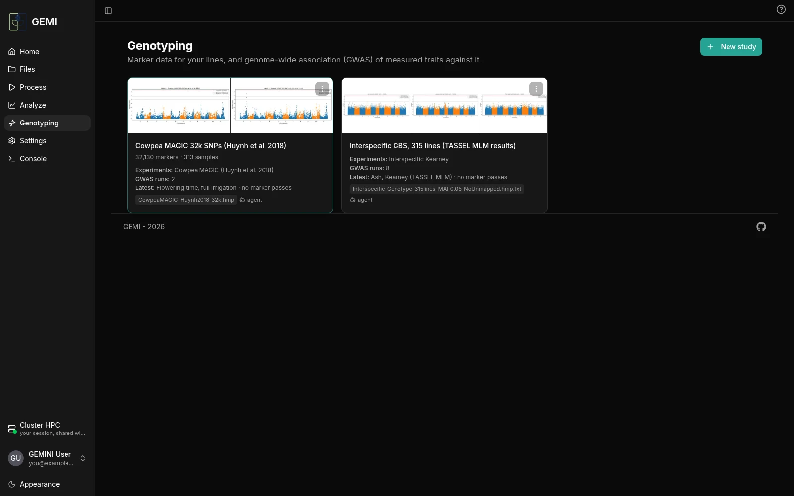
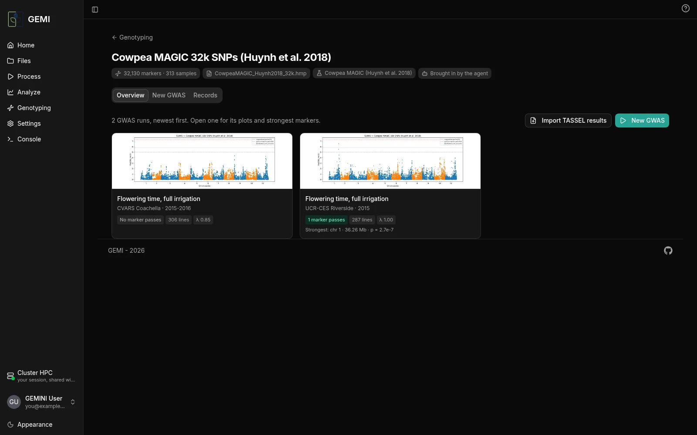
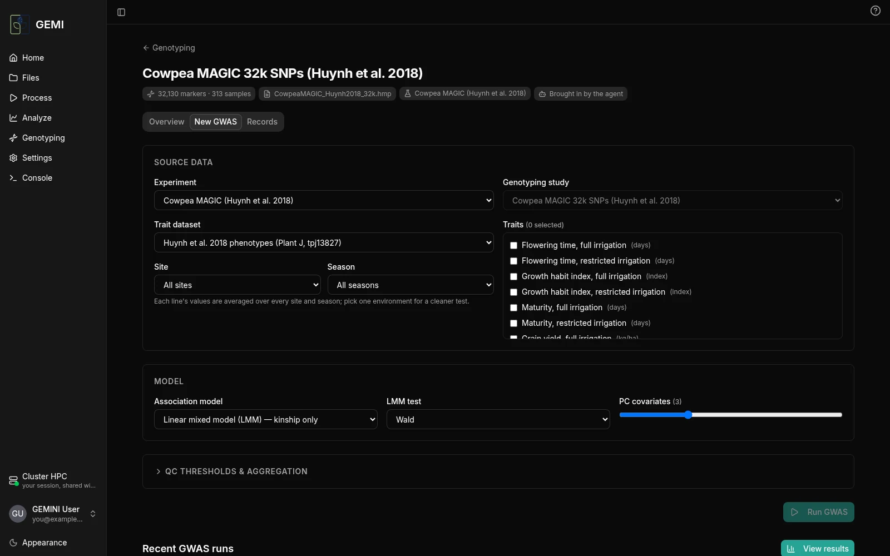
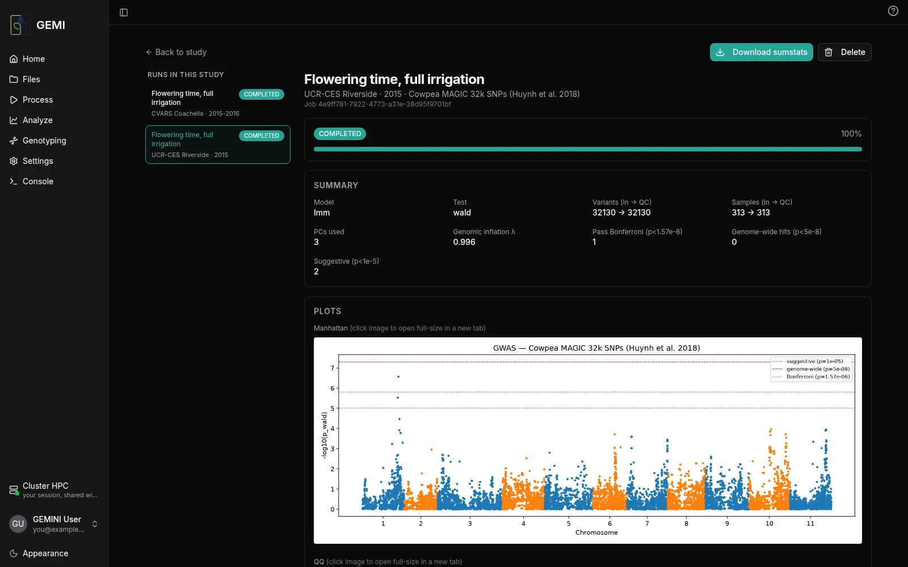
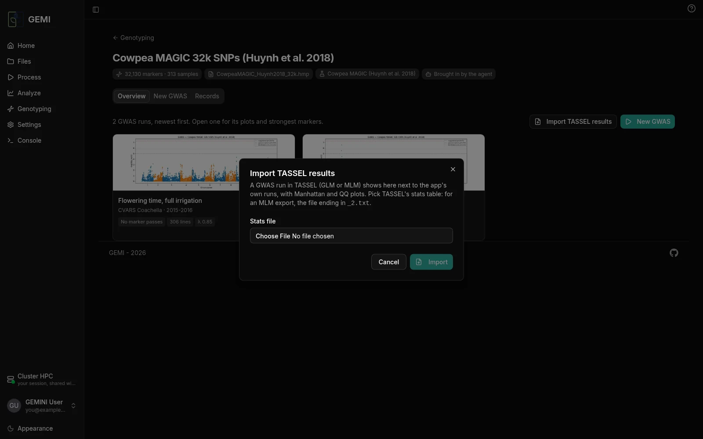

# Genotyping

**Genotyping** holds marker data for your lines and genome-wide association studies (GWAS) of measured traits against those markers.

## Studies

A **study** is one marker set, such as a SNP panel, linked to the experiments whose lines it genotypes. Each card shows:

- the study's size (markers × samples);
- its experiments;
- how many GWAS runs it has, and the latest result;
- thumbnails of its Manhattan plots.

**New study** brings in a marker file: HapMap, VCF, PLINK or CSV. The sample names must match the experiment's line or accession names.

## A study

**Overview** shows the study's GWAS runs as tiles, newest first. Each tile gives the trait, the environment (site and season), how many markers pass the Bonferroni threshold, how many lines were tested, and the genomic inflation λ. Open a tile for its plots and strongest markers.

## Run a GWAS

**New GWAS** sets up a run:

- **Source data**: the experiment, the trait dataset and the traits to test.
- **Environment**: a site and a season. Each line's values are averaged over every site and season you include; one environment gives a cleaner test.
- **Model**: a linear mixed model with a kinship matrix, plus principal components as covariates.
- **QC thresholds**: minor allele frequency, missingness, and how replicates are combined.

## A GWAS run

The run page shows:

- a **summary**: model, test, markers and samples before and after QC, principal components used, genomic inflation λ, and markers passing the Bonferroni, genome-wide and suggestive thresholds;
- the **Manhattan and QQ plots**;
- the **strongest markers**.

**Download sumstats** saves the full results table.

## Import TASSEL results

GWAS runs done in TASSEL (GLM or MLM) can sit beside the app's own. **Import TASSEL results** takes TASSEL's statistics table (for an MLM export, the file ending in `_2.txt`). It draws the same Manhattan and QQ plots.

