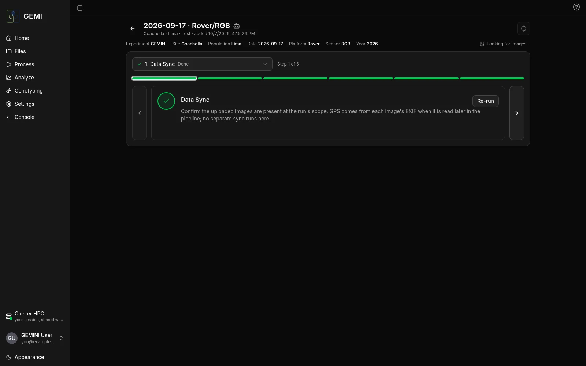
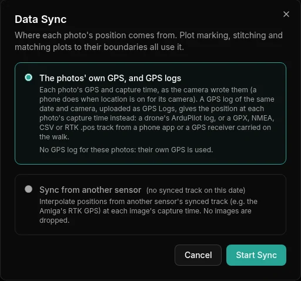
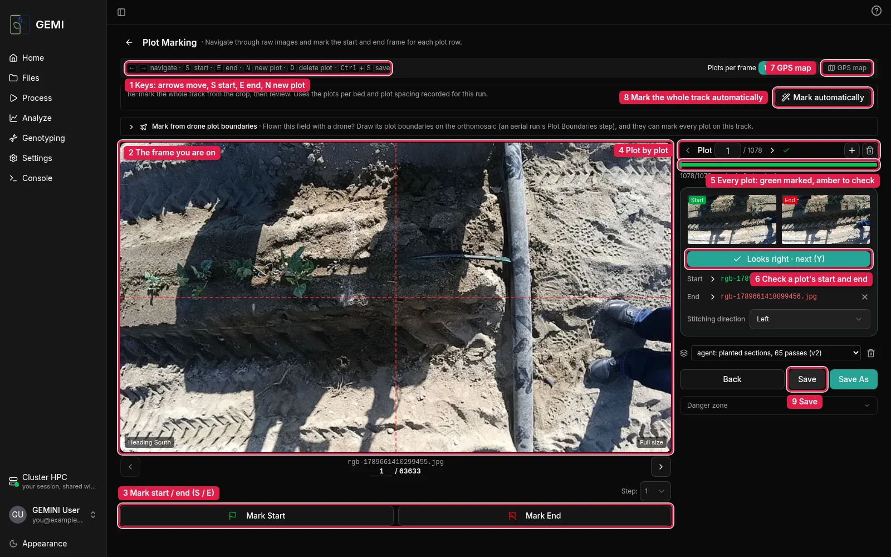
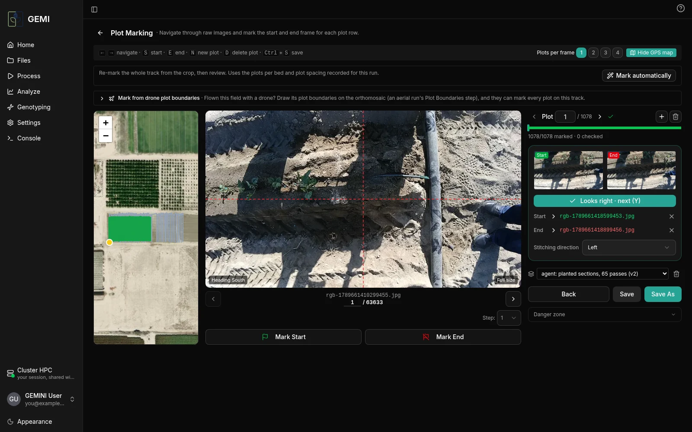
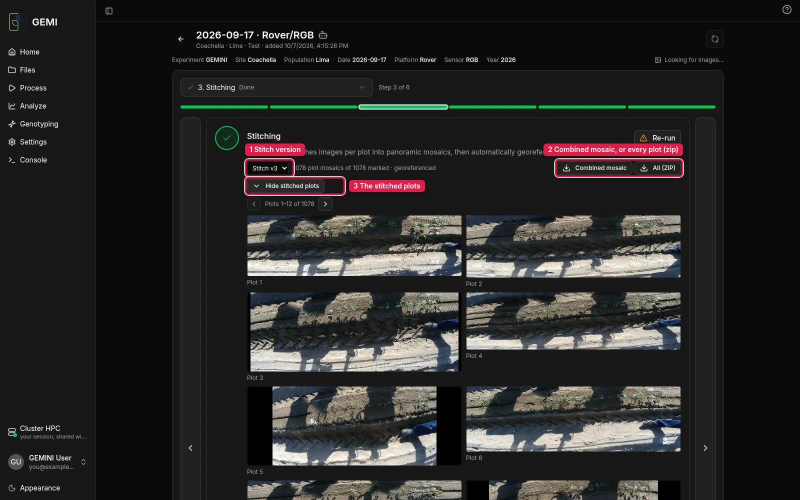
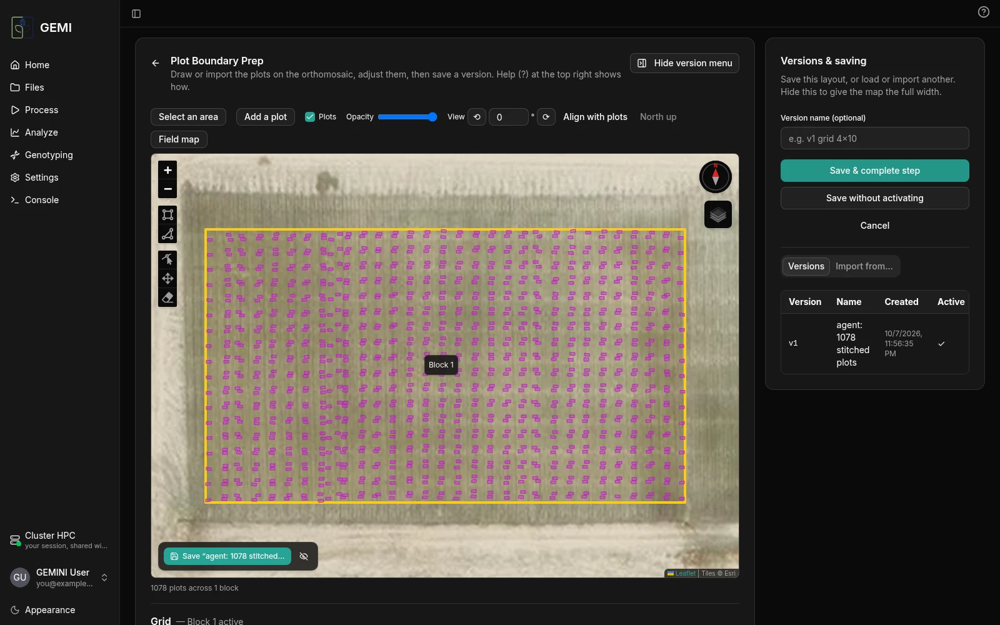
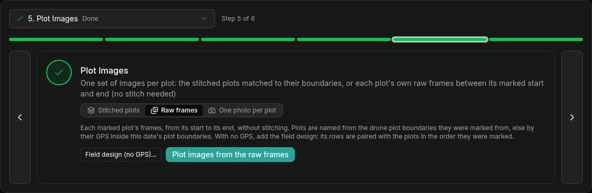
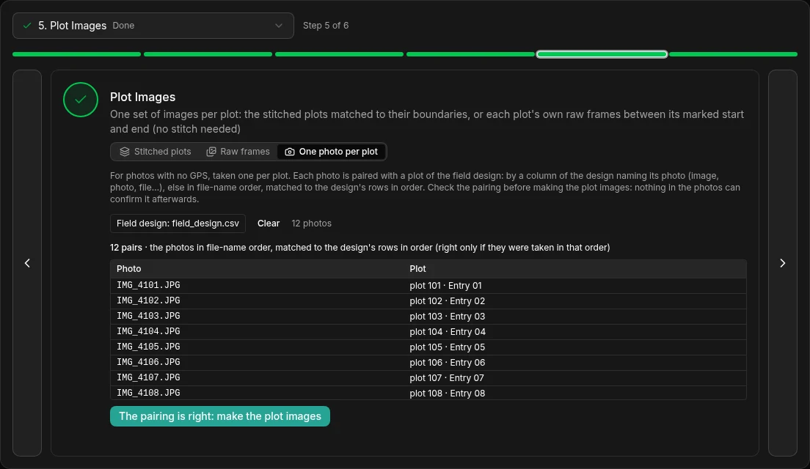

# Ground Pipeline

The ground pipeline processes images taken along the rows: a rover such as a Farm-ng Amiga driving the beds, or a person carrying a phone or camera (handheld). Each plot's stretch of frames is marked. Its plot images are then either stitched into one image of the plot, or taken from the plot's own raw frames. Those images go to Analyze and can be run through a model.

**Rover:** upload the `.bin` logs as **Farm-ng Binary File**. **Handheld:** upload the photos as **Image Data** with platform *Handheld* (see [Upload](upload.md)). Create a **Ground** pipeline in the workspace, then add a run for the upload.

| Step | What it does |
|---|---|
| 1. Data sync | Gives every frame its position: the rover log's GPS, or the photos' own GPS or a GPS log |
| 2. Plot marking | Marks the start and end frame of every plot |
| 3. Stitching (optional) | Stitches each plot's frames into one image (AgRowStitch) and georeferences it |
| 4. Plot boundaries | One polygon per plot with the field design attached (for the stitched plots) |
| 5. Plot images | Each plot's images: its stitched image, its raw frames, or one photo per plot |
| 6. Inference | Runs a model on the plot images (optional) |

Which way through depends on the images:

| Images | Positions | Plot images from |
|---|---|---|
| Rover | its log's GPS | stitched plots, or raw frames |
| Handheld, with GPS | the photos' own GPS (phone location on), or a GPS log carried on the walk | stitched plots, or raw frames, like a rover |
| Handheld walk, no GPS | none | raw frames, paired with the field design in marking order |
| Handheld, one photo per plot, no GPS | none | each photo paired with a plot of the field design |

## 1. Data sync

**Rover:** the frames and GPS track are extracted from the log; nothing needs doing.

**Handheld:** each photo gets its position and capture time. **Start Sync** shows where they come from:

- **The photos' own GPS**, as the camera wrote it. A phone does this when location is on for its camera.
- **A GPS log of the walk**, uploaded as **GPS Logs** for the same date and camera: a GPX or CSV from a GPS app, an NMEA file, or an RTK receiver's `.pos` or CSV. The position at each photo's capture time is interpolated between the log's fixes, so it beats a phone's own GPS. The dialog lists the logs it found.
- **Camera clock:** photos are matched to the log by time. Phones record their time zone; many cameras keep local time without it, and are shifted by the whole hours that line them up with the log. Set the zone yourself if you know it.

The result says how many photos got a position and from where, which logs were used, and any clock shift. Photos with **no GPS at all** are fine: the step says so, and their plots are paired with the field design in the Plot images step.

!!! note "iPhone photos"
    Upload JPEGs. Apple's HEIC format can't be processed: set *Settings → Camera → Formats → Most Compatible*, or export the photos as JPEG with their location.

## 2. Plot marking

Each plot is a stretch of frames between a start frame and an end frame. Open the tool with **Open Tool** on the step.

1. **Keys**: arrow keys move through the frames, `S` marks the start, `E` the end, `N` starts a new plot, `D` deletes one, `Ctrl+S` saves. *Plots per frame* (beside them) is for passes that see more than one plot at once, one per band of the frame.
2. **The frame you are on.** Zoom with the wheel or the buttons; the *Step* setting skips several frames at a time.
3. **Mark start / end** of the current plot.
4. **Plot by plot**: go to a plot by number, or step through them. **+** adds a plot, the bin deletes it.
5. **Every plot on the track** as a strip: green is marked, amber needs a check (a marking carried over from another date, or a frame that no longer exists). Click a segment to go to that plot.
6. **Check a plot**: its start and end frames are shown side by side. *Looks right · next* (`Y`) confirms it and moves on. Set the **stitching direction** for the plot below it.
7. **GPS map**: the track, with the current frame on it.
8. **Mark automatically** marks the whole track from the crop rows. It uses the plots per bed and the plot spacing recorded for the run; review the result afterwards.
9. **Save**, or **Save As** a new version. Saved versions are listed above the buttons.

When the field was also flown with a drone, **Mark from drone plot boundaries** marks every plot from the boundaries drawn on that date's orthomosaic, and the plots keep their drone plot names.

## 3. Stitching (optional)

AgRowStitch stitches each marked plot's frames into one panoramic image of the plot. It then georeferences the plots and makes a combined mosaic. Stitching needs the frames' positions; for images with no GPS, use the raw frames instead.

1. **Stitch version.** Each stitch is kept as a version; pick one to see it.
2. **Download** the combined mosaic, or every plot's image (zip).
3. **The stitched plots**, a page at a time.

Stitching settings (cropping, direction and others) are in the pipeline's **Settings**. If some plots fail or look wrong, change the settings and run the step again. **Re-run** asks before it starts.

## 4. Plot boundaries

The same tool as in the aerial pipeline (see [Plot boundaries](aerial_pipeline.md#5-plot-boundaries)), drawn over the stitched mosaic. Boundaries can also be generated from the stitched plots themselves. The raw frames use boundaries only to name plots by GPS; plots marked from drone boundaries, or paired with a field design, need none.

## 5. Plot images

Choose where each plot's images come from:

- **Stitched plots:** each stitched plot is matched to the boundary that contains it, by GPS. *Show matches* lists them; *Show plot images* shows the images.
- **Raw frames:** each marked plot's own frames, from its start to its end, without stitching. Consecutive frames are aligned with each other, and only frames that don't overlap are kept for counting (the plot's *tiles*); its middle frame is its plot image. A model's counts on the tiles add up to the plot's count without counting a plant twice. Plots are named from the drone boundaries they were marked from, else by their GPS inside the plot boundaries. With no GPS, add the field design: its rows are paired with the plots in the order they were marked, so list the plots in the order walked.
- **One photo per plot:** for handheld photos with no GPS, taken one at each plot. Choose the field design; each photo is paired with a plot, by a column of the design naming the photo (*image*, *photo*, *file*…), else in file-name order. The pairing is shown in full before anything is made; nothing in the photos can confirm it afterwards.

The plot images appear in *Analyze → Query* and in the plot viewer beside the drone's.

## 6. Inference

Runs a model on the plot images, for example to count flowers. For raw frames, pick the image source **Every frame of each plot, no overlap (counts summed)**: each plot's count is the sum over its tiles. See [Inference & Training](inference.md).

!!! tip "Let the agent do it"
    The agent's *ground-pipeline* skill covers rover and handheld runs: syncing positions from a GPS log, marking plots, and plot images from the stitch or the raw frames. Ask it on the Home page, for example: *"mark the plots on the Coachella rover run of 2026-09-17 and make plot images from the raw frames"*.
