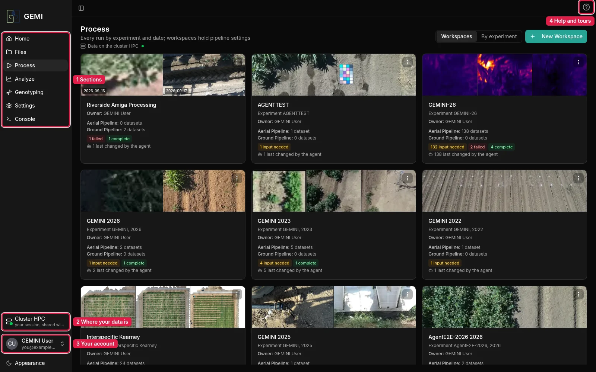
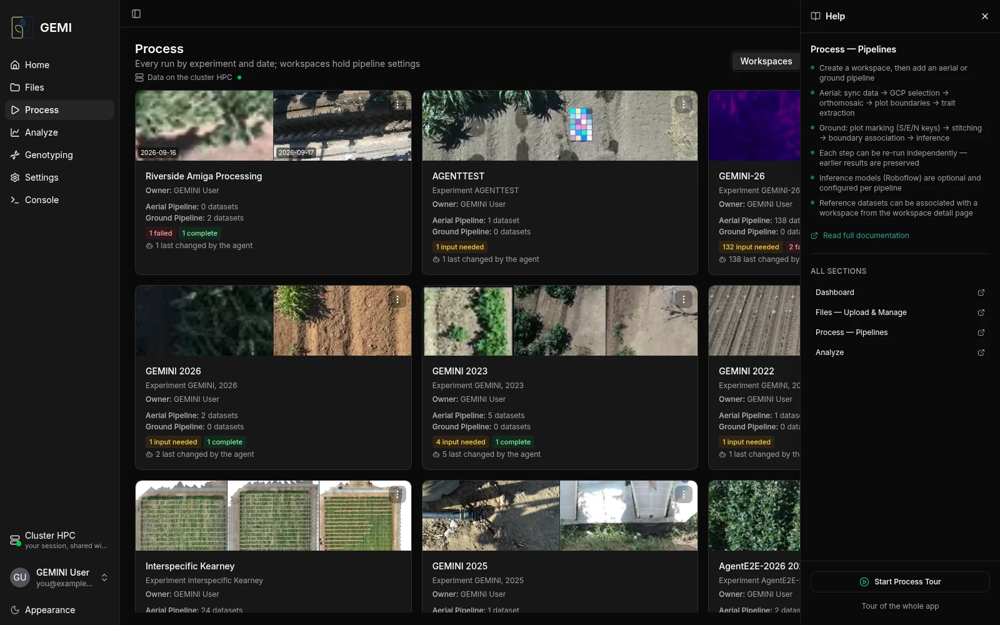

# App Guide

GEMI takes field data from upload to traits. Drone flights and rover runs become orthomosaics, per-plot images and per-plot traits. You can then chart and map those traits, and test them against marker data.

The work happens in four places, each in the sidebar:

1. **Files**: upload drone images, rover logs, orthomosaics, field designs and trait tables.
2. **Process**: each upload becomes a *run*. A run's steps turn it into plot boundaries, plot images and traits.
3. **Analyze**: tables, charts and maps of the traits, plot by plot through the season.
4. **Home**: a dashboard built from your data, and an agent that can do any of the above when you ask in plain words.

**Genotyping** holds marker data and genome-wide association studies (GWAS). **Settings** and **Console** cover setup and logs.

1. **Sections**: the parts of the app.
2. **Where your data is**: this computer, or a cluster session (yours, or one your group shares). Everything you see, and every job you start, lives there. Each place keeps its own experiments: switching moves nothing.
3. **Your account**: sign out, and switch between light and dark themes (*Appearance*).
4. **Help and tours**: what the page does, and a guided tour of it.

## Help on every page

Open **Help** (the **?** at the top right) on any page. It explains that page and offers a step-by-step tour that points at each control. *Tour of the whole app* walks through every section once.

Jobs, uploads and copies in progress appear in a panel at the bottom right of every page. This includes work the agent started. Expand the panel to follow a job or cancel it.

## The guides

-   __📤 Upload__

    ---

    Bring drone, rover and handheld data in from this computer, a cluster folder or online storage.

    [:octicons-arrow-right-24: Upload](upload.md)

-   __🗂 Workspaces & Runs__

    ---

    Workspaces, pipelines, the run list, and how a run's steps work.

    [:octicons-arrow-right-24: Workspaces & Runs](workspaces.md)

-   __🚁 Aerial Pipeline__

    ---

    Orthomosaic, plot boundaries, plot images (from the map or the raw frames, thermal included) and traits.

    [:octicons-arrow-right-24: Aerial Pipeline](aerial_pipeline.md)

-   __🚜 Ground Pipeline__

    ---

    Rover runs: plot marking, stitching and plot images.

    [:octicons-arrow-right-24: Ground Pipeline](ground_pipeline.md)

-   __🔍 Inference & Training__

    ---

    Run detection models on plot images, check their results, label images and train your own.

    [:octicons-arrow-right-24: Inference & Training](inference.md)

-   __📊 Analyze__

    ---

    Table, plot images through the season, single traits, several traits together, maps and weather.

    [:octicons-arrow-right-24: Analyze](analyze.md)

-   __🧬 Genotyping__

    ---

    Marker studies, GWAS runs and imported TASSEL results.

    [:octicons-arrow-right-24: Genotyping](genotyping.md)

-   __🏠 Home: Dashboard & Agent__

    ---

    An overview of an experiment, and the agent.

    [:octicons-arrow-right-24: Home](dashboard.md)

-   __⚙️ Settings & Console__

    ---

    Where work runs, keys and tokens, and the log.

    [:octicons-arrow-right-24: Settings & Console](settings.md)

