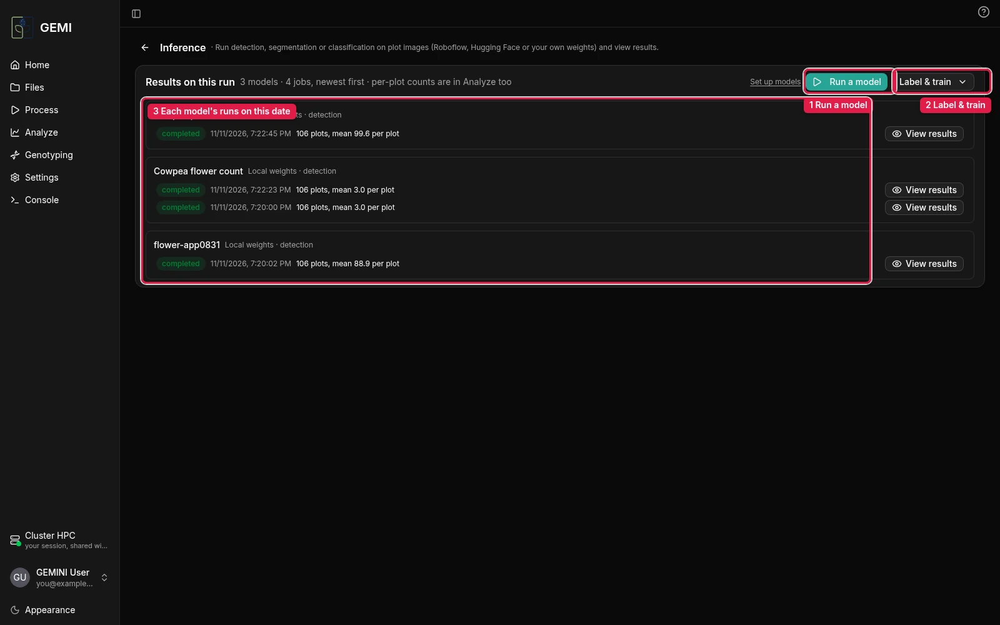
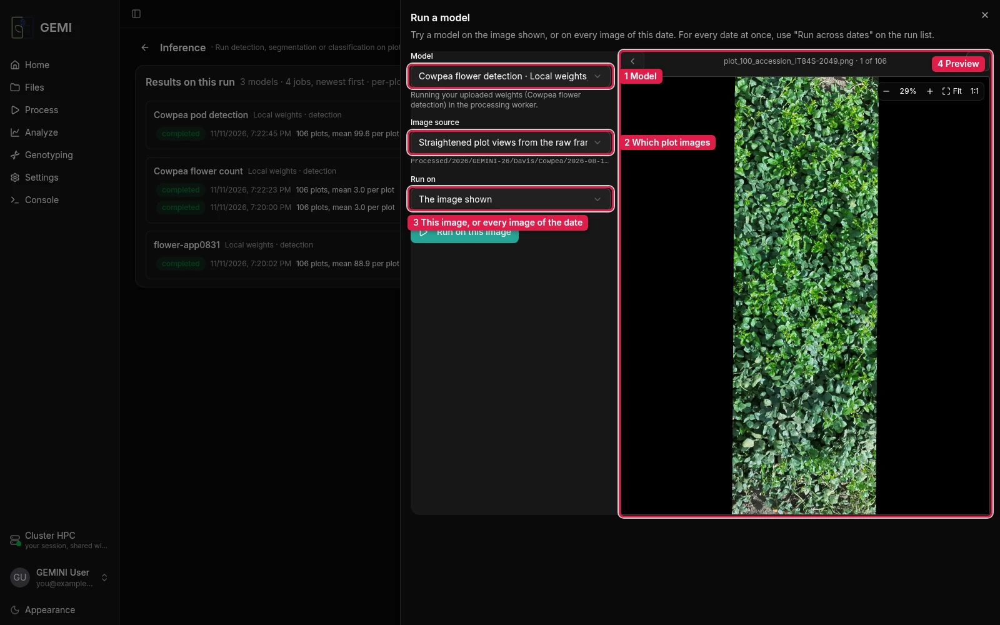
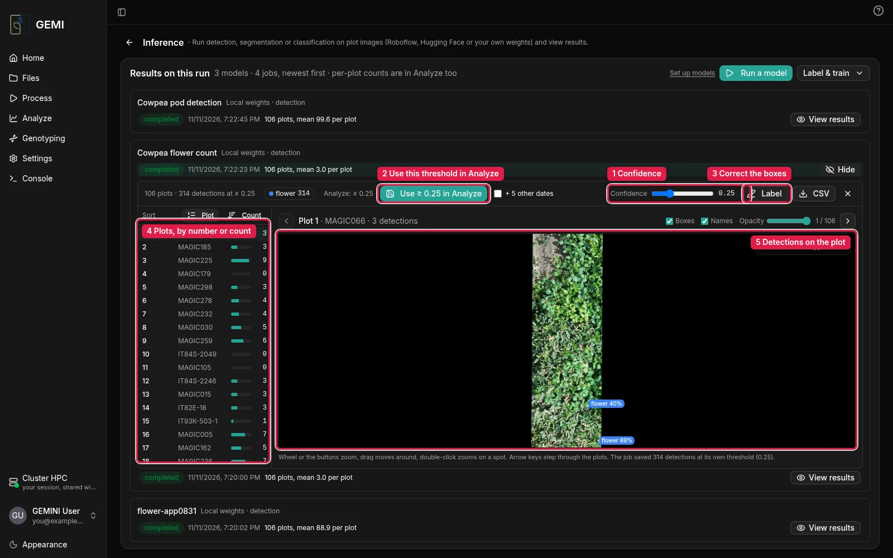
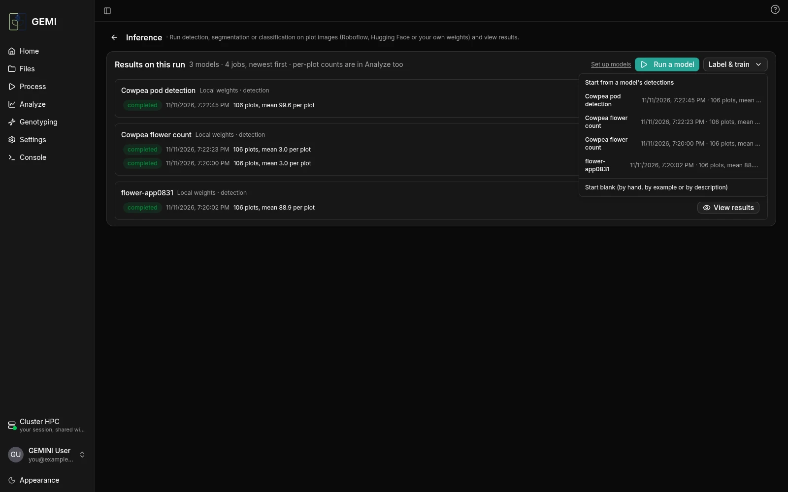

# Inference & Training

**Inference** runs a trained model over a run's plot images. Models can detect and count things (panicles, flowers, pods, seedlings), segment them, or classify plots. A model's per-plot counts are stored as traits and appear in Analyze like any other trait. The step is the last one of both pipelines. Open it with **Open Tool** (or **Re-open Tool**) on a run's *Inference* step.

Models can come from:

- **Roboflow**: a model ID and an API key.
- **Hugging Face**: including zero-shot detectors that find objects from a text description.
- **Your own weights**: a model trained here, or uploaded.

Keys for Roboflow and Hugging Face are saved under *Settings → Keys & tokens*.

## Results on a run

1. **Run a model** on this date's plot images.
2. **Label & train**: label images and train a model of your own (see below).
3. **Each model's runs on this date**, newest first: how many plots and the mean count per plot. **View results** opens the detections.

## Run a model

1. **Model**: one set up for the pipeline (**Set up models**), or any saved one.
2. **Image source**: plot images from the orthomosaic, straightened views from the raw frames, whole raw images, or, for ground runs whose plot images came from the raw frames, **every frame of each plot, no overlap (counts summed)**: each plot's count is the sum over its non-overlapping frames, so no plant is counted twice.
3. **Run on** the image shown (to try the model) or on every image of the date.
4. **Preview**: step through the plot images.

To run a model on every date at once, use **Run across dates** on the workspace's run list (see [Workspaces & Runs](workspaces.md#run-across-dates)).

## Check the results

1. **Confidence**: hide detections below a threshold, and see the counts change.
2. **Use this threshold in Analyze**: the per-plot counts in Analyze use it from then on. Tick *other dates* to apply it to the same model on the other dates.
3. **Label**: correct the boxes on this image (see below).
4. **Plots**, sorted by plot number or by count. Very high or very low counts are the first to check.
5. **The detections** on the plot. Zoom with the wheel and drag to move. Arrow keys step through the plots.

**CSV** downloads the counts.

## Label & train

When no model counts what you need, or counts it badly in your conditions, label some images and train one. Glare, a different growth stage or another camera are common reasons.

- **Start from a model's detections**: the model's boxes are a first draft. Correct them, adding what it missed and removing what it got wrong.
- **Start blank**: draw the boxes by hand, or find objects from an example box or a description.

Labelled images are kept as a **set**, one set per kind of object, shared across dates. **Train** fits a model on the set. Include labelled images from several dates, so the model sees different light and growth stages. When training finishes, the new model appears in the model list for every run.

!!! tip "Compare plots within a date"
    Counts from images depend on the light: sunny dates often count fewer flowers than overcast ones. Compare plots within one date, and look at trends across dates with that in mind.
