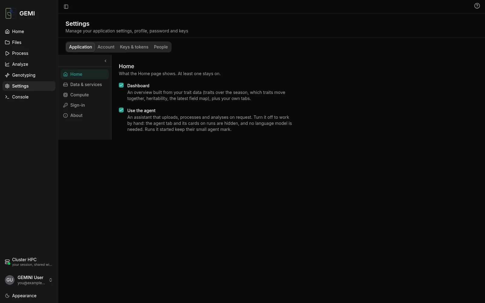
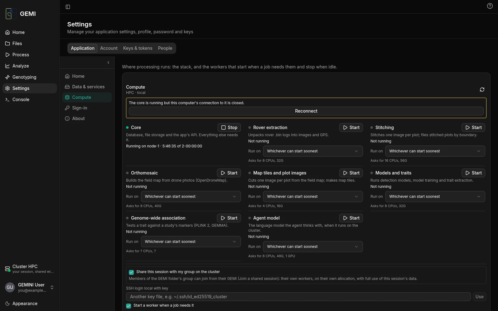
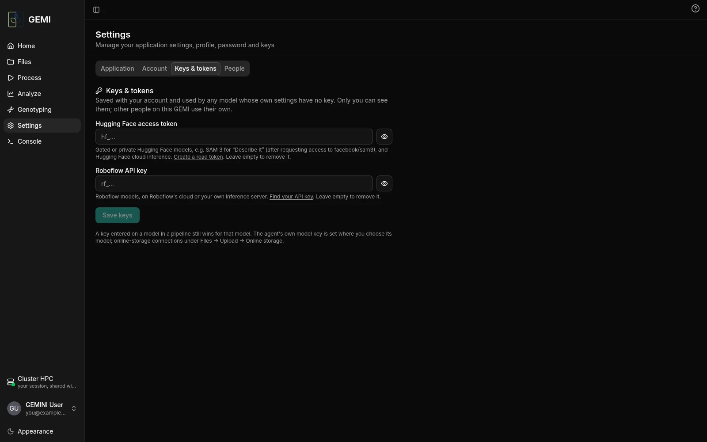
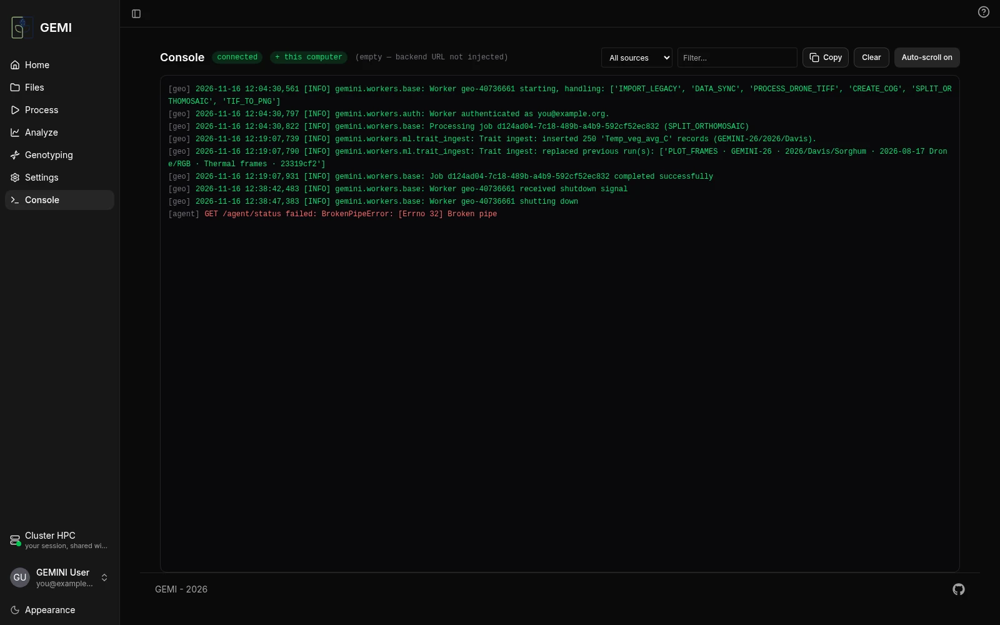

# Settings & Console

## Settings

**Application**

- **Home**: show the dashboard, the agent, or both.
- **Data & services**: where the data is stored and which services the app talks to.
- **Compute**: see below.
- **Sign-in.**
- **About.**

### Compute

Where the processing runs: this computer, or a cluster. Each kind of job has its own worker:

- rover extraction;
- stitching;
- orthomosaic;
- map tiles and plot images;
- models and traits;
- genome-wide association;
- the agent's language model.

A worker starts when a job needs it and stops after a while with no jobs. For each worker you can see whether it is running, start or stop it, and choose where it runs (*Run on*).

On a cluster, **Share this session with my group** lets members of your group join the same session: they start their own workers on their own allocation and work on the same data.

### Keys & tokens

- A **Hugging Face access token**, for gated or private models.
- A **Roboflow API key**, for Roboflow models.

Keys are saved with your account and used by any model that has no key of its own. Only you can see them.

**Account** changes your name and password. **People** sets who each experiment belongs to: a public experiment shows in everyone's lists, a private one only in the lists of the people linked to it. Administrators can add people there.

## Console

The running log of the app, the agent and the jobs, for when something seems stuck. Filter it by source (the jobs on the cluster, the agent, the app) or by text, and copy it to share.

