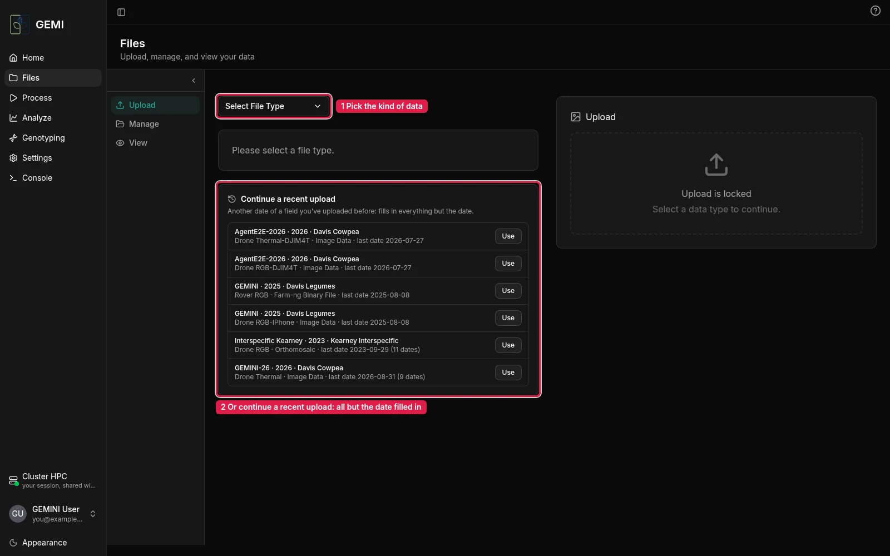
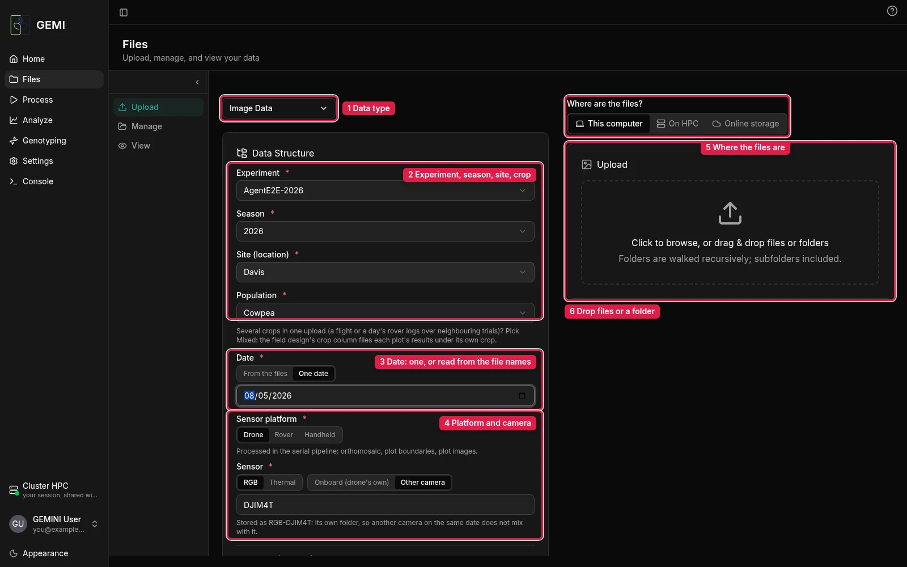
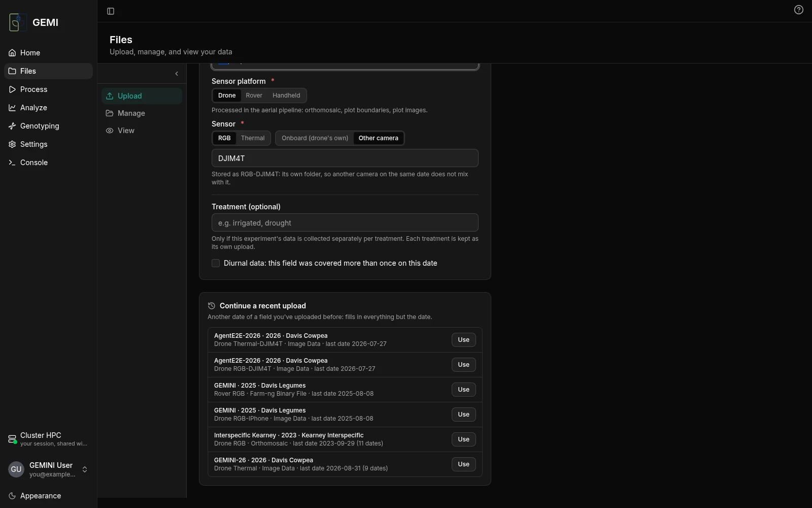
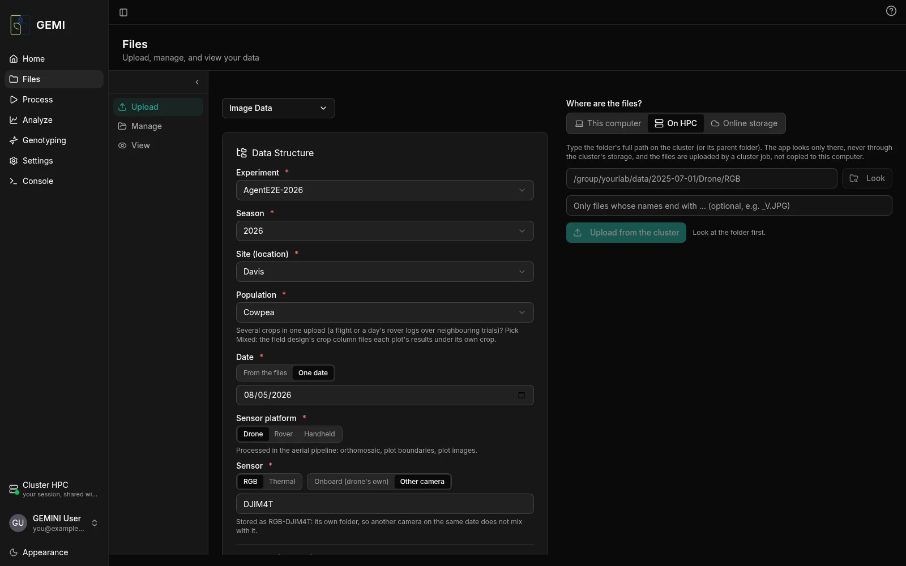
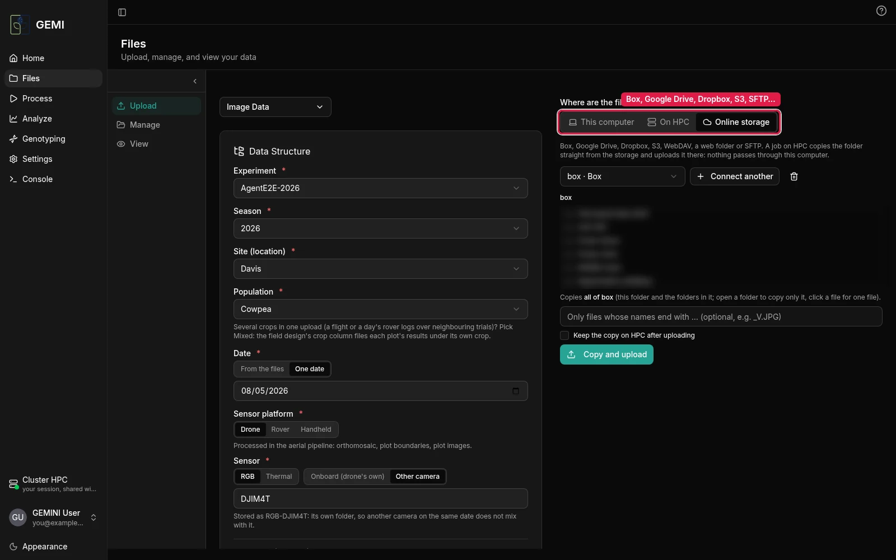
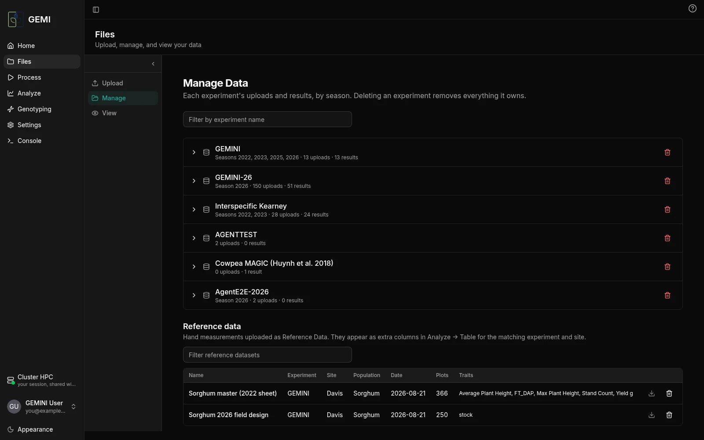
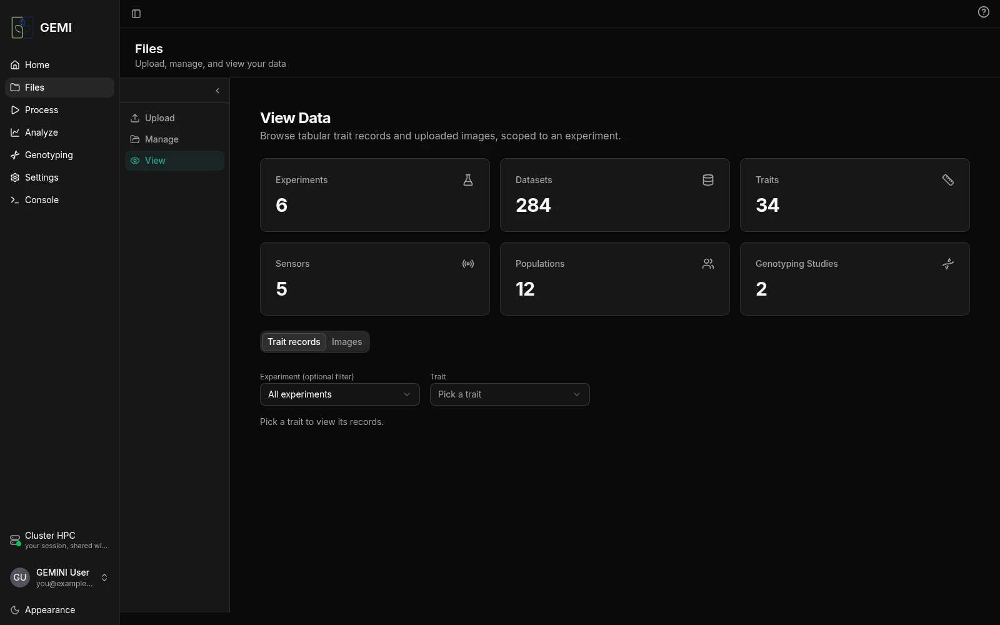

# Upload

Everything starts in **Files → Upload**. You choose what kind of data it is and describe where it belongs (experiment, season, site, crop, date, platform, camera). Then you point the app at the files. The description decides where the data is stored. It also becomes the filter you use later in Process and Analyze, so keep names consistent across uploads.

<video controls muted playsinline width="100%" poster="../video/upload.webp" src="../video/upload.webm"></video>

## 1. Pick the kind of data

1. **Pick the kind of data.** Choose one of:
    - **Image Data**: drone or handheld photos (JPEG, PNG or TIFF; iPhone HEIC photos are refused, with how to get JPEGs).
    - **Farm-ng Binary File**: Amiga rover logs.
    - **Orthomosaic**: a map made elsewhere.
    - **Field Design**: plot, row, column and accession of every plot.
    - **Reference Data**: hand measurements per plot.
    - **Weather Data**: weather station records.
    - **Trait Data**: traits measured elsewhere.
    - **Genomic Data**: marker files.
    - **GPS Logs** and **Synced Metadata**: a drone's flight log, or the GPS track of a walk or drive (GPX, NMEA, CSV from a phone logger or RTK receiver, RTKLIB/Emlid `.pos`), or a GPS table, for images whose own positions are missing or poor.

    Each type shows a short hint in the list of what it is for.
2. **Or continue a recent upload.** Another date of a field you have uploaded before fills in everything except the date.

## 2. Describe the data

1. **Data type**: what you picked above.
2. **Experiment, season, site and population (crop).** Pick existing ones or type new names. A flight over several neighbouring trials can use *Mixed*: the field design's crop column then files each plot's results under its own crop.
3. **Date.** Enter one date, or let the app read it from the file names. Either way you confirm it before anything is uploaded.
4. **Platform and camera.** Drone, rover or handheld (handheld photos with GPS go through the ground pipeline like a rover's; without GPS they are paired with the field design, see [Ground pipeline](ground_pipeline.md#5-plot-images)); RGB, thermal, the drone's own camera, or another camera by name. Each camera is stored in its own folder, so an RGB and a thermal camera flown on the same date never mix.
5. **Where the files are.** See the next section.
6. **The upload area.** Drop files or whole folders here, or click to browse. Subfolders are included.

Further down the form:

- **Treatment (optional).** Use this when an experiment's data is collected separately per treatment, for example a well-watered and a drought block flown as two flights. Each treatment is kept as its own upload. Its runs are processed together, but the results stay apart.
- **Diurnal data.** Tick this when the field was covered more than once on the same date. Each pass then becomes its own run.

## 3. Where the files are

**This computer**: drop or browse files as above.

**On the cluster**: when the app runs on a cluster, type the folder's full path there. *Look* lists what is in it before anything is copied. The files are uploaded by a job on the cluster and never pass through your computer.

**Online storage**: Box, Google Drive, Dropbox, S3, WebDAV, a web folder or SFTP. Connect an account once and browse its folders. A job copies the folder straight from the storage, so nothing passes through your computer. To take only some files, give the ending their names share (for example `_V.JPG`).

## 4. Check what is stored

Uploads run in the background and appear in the jobs panel at the bottom right.

**Manage** lists each experiment's uploads and results by season. Deleting an experiment removes everything it holds. Reference data tables are listed below the experiments. They appear as extra columns in *Analyze → Table* for the matching experiment and site.

**View** counts what the app holds (experiments, datasets, traits, sensors, populations, genotyping studies). It also shows trait records and uploaded images, filtered to an experiment.

!!! tip "Uploading by asking"
    The agent on the Home page can upload too. For example: *"upload the drone flight in /data/2026-08-17/RGB to GEMINI-26, Davis, Sorghum"*.
