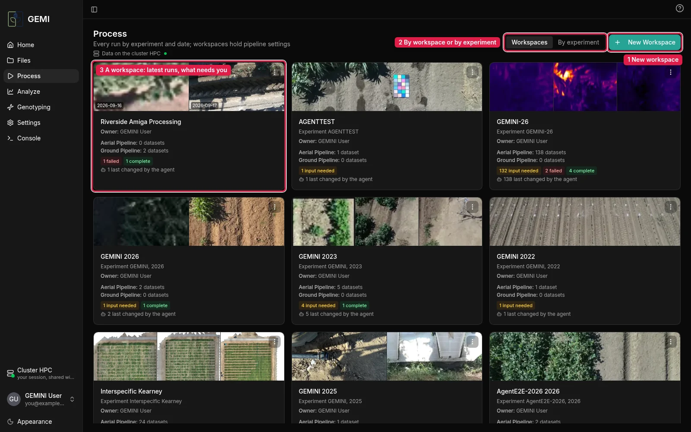
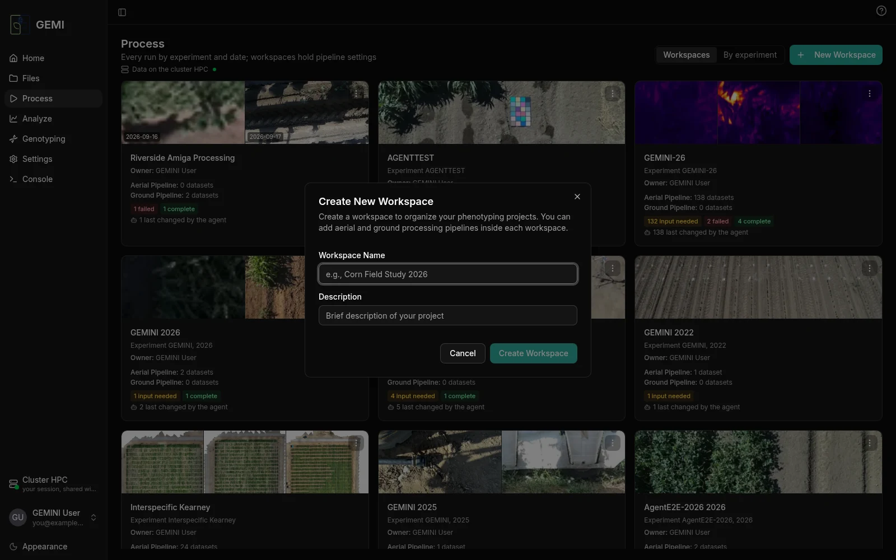
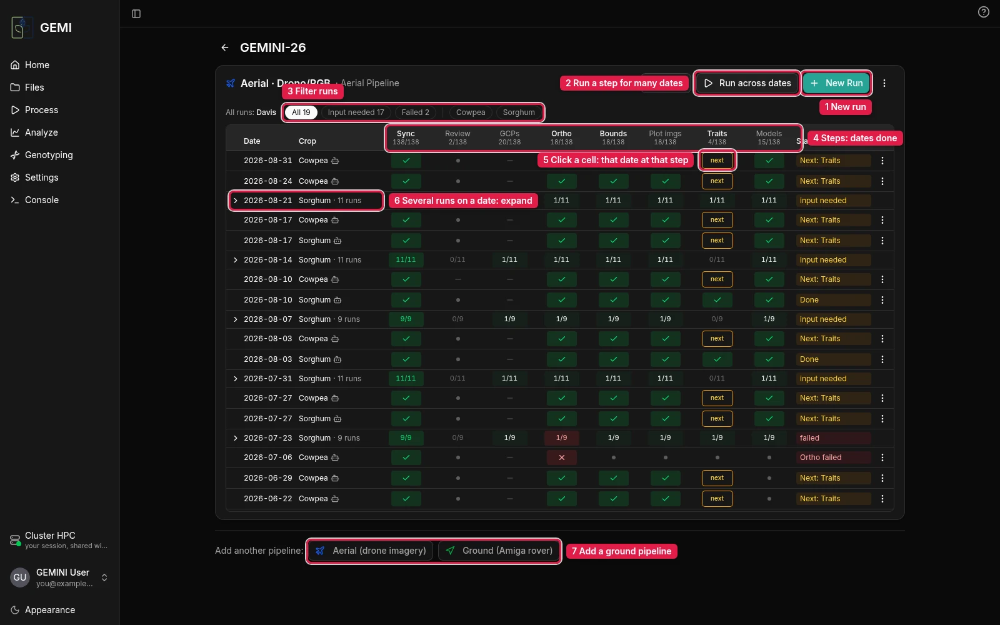
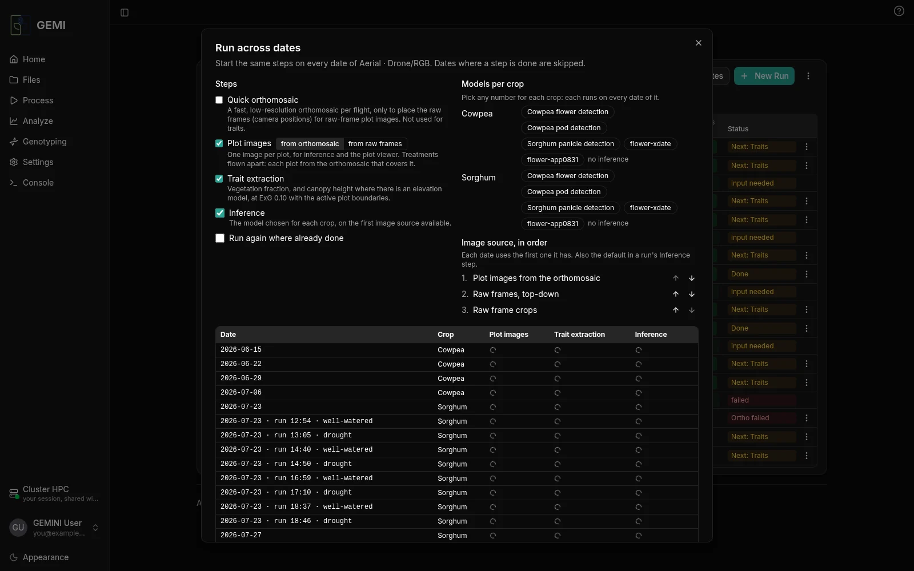
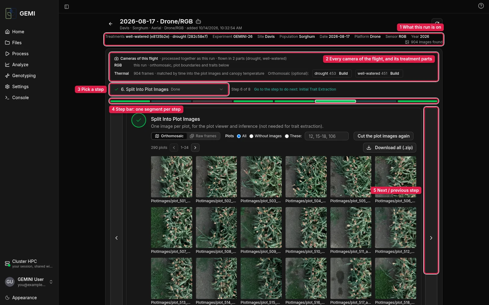

# Workspaces & Runs

**Process** is where uploads are turned into results:

- A **workspace** groups the pipelines of one field experiment.
- A **pipeline** holds the processing settings for one kind of data: *Aerial* for drone images, *Ground* for Amiga rover runs.
- Each upload processed by a pipeline is a **run**: one date, one flight or rover pass.

<video controls muted playsinline width="100%" poster="../video/process-tour.webp" src="../video/process-tour.webm"></video>

## Workspaces

1. **New workspace**: give it a name and a short description.
2. **By workspace or by experiment.** *By experiment* lists every run by experiment and date, whatever workspace it is in.
3. **A workspace card** shows previews of its latest runs, how many runs are in each pipeline, and how many need you (input needed, failed, complete). Runs started or changed by the agent carry a small robot mark.

## A workspace's runs

Open a workspace to see its runs: one row per date, one column per step.

1. **New run**: pick an uploaded dataset to process.
2. **Run across dates**: run the same steps on every date at once (see below).
3. **Filter runs** by status or crop.
4. **One column per step.** The header counts how many dates have that step done.
5. **Click any cell** to open that date at that step. A tick means done. *next* is what that date needs next.
6. **Several runs on one date** (a field flown in parts, several treatments, or diurnal passes) fold into one row. Expand it for a row per run.
7. **Add another pipeline**, for example a ground pipeline beside the aerial one.

**Settings** holds the pipeline's processing settings: orthomosaic quality, stitching parameters and models.

### Run across dates

Starts the same steps on every date of the pipeline and skips dates where a step is already done. Tick the steps to run:

- **Quick orthomosaic**: a fast map per flight, enough to place plot boundaries and pick raw frames.
- **Plot images**: from the orthomosaic, or from the raw frames.
- **Trait extraction.**
- **Inference**, with one or more models per crop.

Under **Image source**, set the order in which each date's plot images are tried. The table at the bottom shows each date's progress.

## A run

A run page shows one step at a time.

1. **What this run is on**: experiment, site, crop, date, platform, camera, the treatments flown, and how many images were found.
2. **Cameras of this flight.** A flight can carry more than one camera, for example a thermal camera beside the RGB one. Every camera's upload belongs to the one run:
    - The RGB camera builds the orthomosaic, the boundaries and the traits.
    - The other cameras' frames are matched to the RGB frames by capture time. They go into the plot images, and a thermal camera also gives each plot's canopy temperature. Nothing needs doing for that.
    - When the field was flown in parts (for example one flight per treatment), each camera's row lists those parts. An orthomosaic of another camera is optional, and can be built per part from here.
3. **Pick a step.** Each step shows its status in the list.
4. **The step bar**: one segment per step, coloured by status (done, to do, running, failed, skipped). Click a segment to open that step.
5. **Next / previous step.** A step unlocks once what it needs is done. Hover a locked arrow to see what is left.

**Go to the step to do next** jumps to the first step still to do. Any finished step can be re-run; the earlier result is kept as a version.

The steps of each pipeline are described in [Aerial Pipeline](aerial_pipeline.md) and [Ground Pipeline](ground_pipeline.md).
