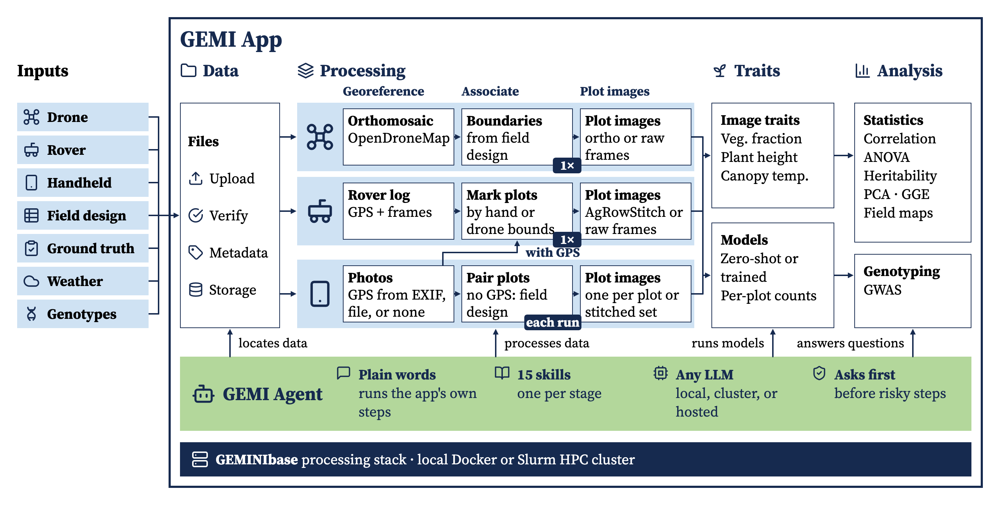

# User Guide

GEMI (short for GxExMINI) is a desktop app for Windows, macOS and Linux. It turns drone flights, rover runs and handheld photos into per-plot images and trait measurements, and analyses them alongside field designs, weather and genotype data. An optional AI agent can do the processing for you when you ask.

Each kind of image has its own path to plot images:

- **Drone**: an orthomosaic (OpenDroneMap), plot boundaries drawn once from the field design, then plot images from the orthomosaic or the raw frames.
- **Rover**: the log's GPS and frames, plots marked by hand or from the drone's plot boundaries, then plot images stitched with AgRowStitch or taken from the raw frames.
- **Handheld**: photos with GPS (the camera's own, or a GPS log) go the rover's way. Photos without GPS are paired with the field design, one per plot or along a marked walk.

The plot images then give traits (vegetation fraction, plant height, canopy temperature, and counts from detection models) for statistics, field maps and GWAS.

## Install

Download the installer for your system from the [releases page](https://github.com/GEMINI-Breeding/GEMINI-App/releases) and open GEMI.

If macOS says the app cannot be opened, allow it under *System Settings → Privacy & Security → Open Anyway*.

## Where the processing runs

The heavy work (orthomosaics, stitching, models) runs in a **processing stack** (GEMINIbase): a database, file storage and workers. GEMI needs one of these:

| Where | What you need | Good for |
|---|---|---|
| **This computer** | [Docker Desktop](https://www.docker.com/products/docker-desktop/) | Small data sets, trying things out |
| **A cluster (HPC)** | A Slurm cluster with Apptainer that you can log in to with an SSH key (no password or two-factor prompt) | Whole fields and seasons |

**On this computer**, GEMI downloads Docker Desktop and opens its installer for you; your system asks you to approve it. On Linux it shows the terminal commands instead. The first start downloads the core services (about 2 GB) and opens; the processing workers (about 6 GB more) follow in the background, and a job started before its worker is up waits for it. Altogether the services take about 18 GB on the drive Docker keeps its programs on. With an NVIDIA graphics card that Docker can use (Windows with WSL 2, or Linux with the NVIDIA container toolkit), models run on the card.

**On a cluster**, nothing has to be installed beforehand. Give the agent your SSH login command and it sets GEMI up there, asking before each step that changes something on the cluster. On Windows, GEMI first installs Git for Windows for your user (no administrator rights), for the ssh and bash the cluster tools use.

- Every action on the cluster goes through one script, confined to GEMI's own folder, with job size limits and a log of every call.
- Workers stop themselves when no job needs them, and start again when work arrives.
- A core started on newer code updates its database by itself, after saving a copy.
- A session can be shared with your group: members run their own workers on their own allocation, with a workers' login that changes at every start, never your own keys.

## First run

A short walkthrough asks three things. Each can be changed later in Settings:

1. **Where the processing runs**: this computer or a cluster.
2. **How you want to work**: with the agent, or by hand. Working by hand needs no language model; every step can be done in the app.
3. **Which model the agent uses** (only with the agent):
    - a free open model on this computer, through [Ollama](https://ollama.com), which GEMI installs for your user without administrator rights;
    - a free open model on your cluster's GPUs (installed for you; 20 to 60 minutes the first time);
    - a hosted model with an API key (Anthropic Claude, OpenAI or a compatible service). Your requests and data then go to that provider.

The app signs in by itself with its own stack's account. To require a login (a shared computer, several people), turn it on under *Settings → Sign-in*.

Then follow the [App Guide](../app_guide/index.md) for each step. Every page also has its own **Help** and guided tour.

## Using GEMI from a coding agent

The installed app contains `gemi-agent`, with every tool the in-app agent has. A coding agent (Claude Code, Codex, Gemini CLI or any MCP client) can use it with its own model; see the [agent guide](https://github.com/GEMINI-Breeding/GEMINI-App/blob/main/docs/AGENT.md).

## Example data

[Example data sets](https://ucdavis.box.com/s/ts802xlcddyufixfjmeayxwiiz2mxrb9) are available to try the app with.

## Problems and suggestions

Report them on [GitHub](https://github.com/GEMINI-Breeding/GEMINI-App/issues).
